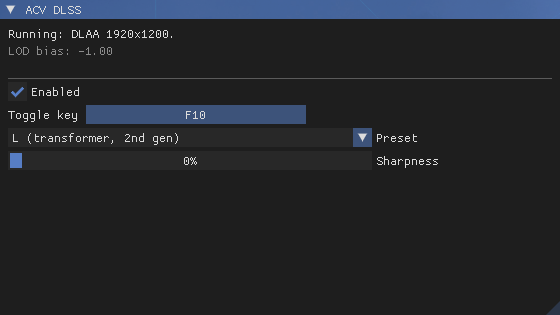
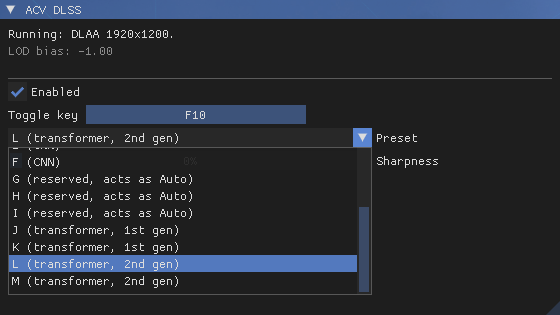

# ACV DLSS

ReShade add-on that replaces Assassin's Creed Valhalla's own anti-aliasing (TAA)
with NVIDIA DLSS.

Needs an NVIDIA RTX graphics card.

## How it works

Valhalla's TAA reads seven textures from one descriptor table. The first three
are the frame, its packed motion vectors and linear depth. The add-on
recognizes that table when the game binds it, and on the next draw it:

1. unpacks the motion vectors and converts depth into what DLSS expects
2. runs DLSS with the jitter and camera from the game's own constant buffers
3. sharpens the result with RCAS if asked
4. copies it into the render target the TAA would have written

The game's TAA draws are then skipped. Everything drawn after that works on the
DLSS image, including the HUD.

## Resolution scale

The game's **Resolution Scale** setting decides what DLSS does:

- **100%** runs DLAA at your screen's resolution.
- **Below 100%** the game renders smaller and DLSS upscales the frame to your
  screen. The game's pass that stretches its TAA output to the screen gets the
  DLSS image instead, and reflections and other passes that read the TAA output
  get a render-size copy.
- **Above 100%** DLSS runs as DLAA at the larger size and the game scales it
  down as usual.

With **FSR** as the game's upscaler, DLSS takes FSR 1's place and FSR 1's
sharpening is skipped.

Textures get the negative mip LOD bias NVIDIA recommends, which is
log2(render / output) - 1. That is -1 at 100% and above and about -1.5 at
70%. Only tiling material textures get it, never screen effects such as
exposure.

The game builds the bias into its pipelines at start up, so restart the game
after changing the resolution scale. Until you do, the window shows the new
bias in amber. The first start with the add-on and the first start after a
change take longer than usual while the game rebuilds its pipeline cache. Let
it finish, because closing the game during the rebuild can leave a broken cache
behind.

## Installing

1. Install ReShade 6.8 or newer with add-on support.
2. Download the latest DLSS DLL from
   [TechPowerUp](https://www.techpowerup.com/download/nvidia-dlss-dll/).
3. Copy `acvdlss.addon64` and `nvngx_dlss.dll` next to `ACValhalla.exe`, where
   ReShade's DLL is.
4. Set **Anti-aliasing** to **High** in the game's graphics options.

## Settings

Open the ReShade overlay to find the **ACV DLSS** window. The top of it shows
what DLSS is doing right now and the current LOD bias.



- **Enabled** switches between DLSS and the game's own TAA.
- **Toggle key** does the same while playing. It's F10 by default. Click the
  button and press another key to change it. Esc cancels and Backspace leaves
  it without a key. Keys ReShade already uses are skipped.
- **Preset** chooses the DLSS model. **Auto** lets DLSS pick the one NVIDIA
  recommends for your card. J and K are the first generation of transformer
  models and L and M the second. E and F are the older CNN models. NVIDIA
  removed A to D from current DLSS and reserves G, H and I, so those act as
  Auto.

  

- **Sharpness** applies AMD's RCAS to the DLSS image before the HUD is drawn.

Each switch shows "DLSS: On" or "DLSS: Off" in the top left corner for a few
seconds. Settings are saved to `ReShade.ini` under `[ACVDLSS]`.

## Good to know

- Menus and loading screens show the game's own image because the game draws
  them without TAA. DLSS takes over again once you're back in the game.
- Dialogue cutscenes work with DLSS too, including the letterboxed ones.
- ShortFuse's RenoDX DLSS works well with it. Its **Render** and **Upscaled**
  hook methods apply DLSS 5 neural rendering inside the DLSS pass with the
  game's motion vectors. Applied to the final image instead, it is less stable
  without them.
- Don't combine it with another mod that replaces the game's anti-aliasing.

## Building

Visual Studio 2022 and CMake. Clone the dependencies into `deps` first, from the
repository root:

```
git clone --depth 1 --branch v6.8.0 https://github.com/crosire/reshade.git deps\reshade
```

ReShade passes its own ImGui functions to add-ons, so the ImGui commit has to
match the one ReShade pins. For v6.8.0 it's `3912b3d9a9c1b3f17431aebafd86d2f40ee6e59c`:

```
git clone https://github.com/ocornut/imgui.git deps\imgui
```
```
git -C deps\imgui checkout 3912b3d9a9c1b3f17431aebafd86d2f40ee6e59c
```

Only the headers and libraries of the DLSS SDK are needed, which a sparse clone
gets without the rest:

```
git clone --depth 1 --filter=blob:none --sparse https://github.com/NVIDIA/DLSS.git deps\dlss
```
```
git -C deps\dlss sparse-checkout set include lib/Windows_x86_64/x64
```

Then:

```
cmake -S . -B build -G "Visual Studio 17 2022" -A x64
```
```
cmake --build build --config Release
```

The shaders are compiled with `fxc` from the Windows SDK during the build.
Output: `build\Release\acvdlss.addon64`.

## Third-party licenses

- [ReShade](https://github.com/crosire/reshade), BSD 3-Clause, copyright Patrick
  Mours. `descriptor_tracking.cpp` from its examples is built in.
- [Dear ImGui](https://github.com/ocornut/imgui), MIT, copyright Omar Cornut.
- [NVIDIA DLSS SDK](https://github.com/NVIDIA/DLSS), under the NVIDIA RTX SDKs
  license. DLSS and NVIDIA are trademarks of NVIDIA Corporation.
- `shaders\rcas.hlsl` follows RCAS from AMD FidelityFX Super Resolution 1, MIT,
  copyright Advanced Micro Devices, Inc.

Not affiliated with NVIDIA, AMD, Ubisoft or the ReShade project.

## Acknowledgements

The DLSS mods for [Assassin's Creed Odyssey](https://www.nexusmods.com/assassinscreedodyssey/mods/466)
and [Assassin's Creed Origins](https://www.nexusmods.com/assassinscreedorigins/mods/339)
were the inspiration for this add-on.

## Development note

AI assistance was used during development, for reviewing code, finding bugs,
refining the implementation and writing documentation. All changes were reviewed
and tested before being included.

## License

MIT
