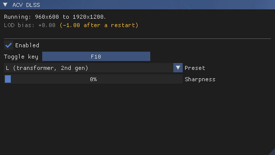
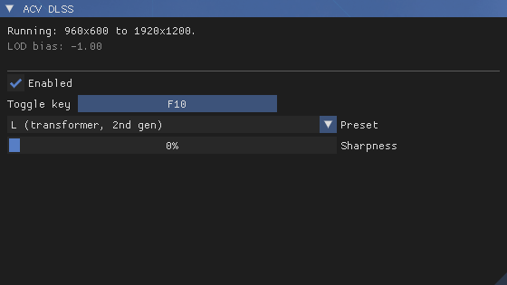

# ACV DLSS

ReShade add-on that replaces Assassin's Creed Valhalla's own anti-aliasing (TAA)
with NVIDIA DLSS, with experimental NVIDIA Reflex.

Needs an NVIDIA RTX graphics card.

## How it works

Valhalla's TAA reads seven textures from one descriptor table. The first three
are the frame, its packed motion vectors and linear depth. The add-on
recognizes that table when the game binds it, and on the next draw it:

1. unpacks the motion vectors and converts depth into what DLSS expects
2. runs DLSS with the jitter and camera from the game's own constant buffers
3. sharpens the result with RCAS (optional)
4. copies it into the TAA's own output texture

It skips the game's TAA and everything drawn after that works on the DLSS
image, including the HUD.

When DLSS upscales, the add-on has the game's camera cycle through 16 or 32
sub-pixel positions instead of its usual 8, as NVIDIA recommends for DLSS.

## Resolution scale

The game's **Resolution Scale** setting decides what DLSS does:

- **100%** runs DLAA at your screen's resolution.
- **Below 100%** the game renders smaller and DLSS upscales the frame to your
  screen. The game's pass that stretches its TAA output to the screen gets the
  DLSS image instead, and reflections and other passes that read the TAA output
  get a render-size copy.
- **Above 100%** DLSS runs as DLAA at the larger size and the game scales it
  down as usual.
- **FSR** as the game's upscaler works too. DLSS takes FSR 1's place and FSR
  1's sharpening is skipped. With the resolution scale at 100%, this is the
  best way to render below your screen's resolution, because textures keep
  their full detail (see below).

> [!WARNING]
> **Leave the game's Adaptive Quality off.** Dynamic resolution isn't supported
> yet. With it on, the picture flickers between DLSS and the game's TAA
> whenever the internal render resolution changes.

## Texture detail

The game loads texture detail for the resolution scale's size. FSR renders
smaller than that, so with FSR on the textures get a negative mip LOD bias to
make up the difference: -1 at Performance, about -0.38 at Ultra Quality. With
FSR off there's no bias, since the game already renders at the size it loads
detail for. Only tiling material textures get it, never screen effects.

NVIDIA's guidelines add another -1 on top. In this game that asks for detail
it never loads, and the ground turns black up close where leaves and debris
lie, so it isn't used.

DLSS picks up a new FSR mode straight away, but the LOD bias needs a restart,
because the game builds it into its pipelines at start up. The first start after the bias changes is slow while the game rebuilds its
pipeline cache. Play for 3 minutes with DLSS on after it, or the next start
rebuilds the cache again.





## Installing

1. Install ReShade 6.8 or newer with add-on support.
2. Download the latest DLSS DLL from
   [TechPowerUp](https://www.techpowerup.com/download/nvidia-dlss-dll/).
3. Copy `acvdlss.addon64`, `acvdlss.ini` and `nvngx_dlss.dll` next to
   `ACValhalla.exe`, where ReShade's DLL is.
4. Set **Anti-aliasing** to **High** in the game's graphics options.
5. Start the game. The first start after installing or updating is slow while
   the game rebuilds its pipeline cache. Play for 3 minutes with DLSS on after
   it.

## Settings

Open the ReShade overlay to find the **ACV DLSS** window. The top of it shows
what DLSS is doing right now, and the LOD bias when FSR is on.


- **Enabled** switches between DLSS and the game's own TAA.
- **Toggle key** does the same while playing. It's F10 by default but you can
  map it to any key: click the button and press the key. Esc cancels and
  Backspace leaves it without a key. Keys ReShade already uses are skipped.
  Each switch displays "DLSS: On" or "DLSS: Off" in the top-left corner for a
  few seconds.
- **Preset** chooses the DLSS model. **Auto** lets DLSS pick the one NVIDIA
  recommends for your card. J and K are the first generation of transformer
  models and L and M the second. E and F are the older CNN models. NVIDIA
  removed A to D from current DLSS and reserves G, H and I, so those act as
  Auto.

  

- **Sharpness** applies AMD's RCAS to the DLSS image before the HUD is drawn.
- **NVIDIA Reflex** is experimental, see below.

All settings are saved in `acvdlss.ini` next to `ACValhalla.exe`. These can
only be changed there:

- `HudlessImage` under `[OptiScaler]`, see the frame generation section.
- `JitterPositions` under `[Advanced]`: `Auto`, or force 8, 16 or 32 camera
  positions.
- `Debug` under `[Diagnostics]` writes a detailed log.

## NVIDIA Reflex (experimental)

Reflex is a work in progress and off by default.

- **On** keeps frames from queueing up for the graphics card, so your input
  reaches the screen sooner. In testing, GPU bound at about 35 fps, it cut
  input latency by about a third, with no loss in frame rate.
- **On + Boost** also keeps the graphics card's clocks up when the CPU is the
  limit. It makes no difference while the graphics card is the limit.
- It's switched off by itself, with the option greyed out, while OptiScaler's
  frame generation is in use. See the next section.
- It overrides frame rate caps that work through Reflex, like RTSS in Reflex
  mode or the NVIDIA App's Max Frame Rate. Use the game's own frame limit
  instead.

## Frame generation with OptiScaler

ACV DLSS gives the game a real DLSS integration, so
[OptiScaler](https://github.com/optiscaler/OptiScaler) can run frame generation
from it: DLSS frame generation, FSR frame generation or XeSS frame generation.
Tested with an OptiScaler nightly build (10.0.0-dev, November 2026).

Setup:

1. Install ACV DLSS as above.
2. Install OptiScaler as `winmm.dll` next to `ACValhalla.exe`.
3. Rename ReShade's DLL (usually `dxgi.dll`) to `ReShade64.dll` and set
   `LoadReshade = true` in `OptiScaler.ini`, so OptiScaler loads ReShade. With
   ReShade as `dxgi.dll`, frame generation crashes.
4. In `OptiScaler.ini`, set `FGInput = upscaler` and `FGOutput` to `dlssg`,
   `fsrfg` or `xefg`. Then start the game and press **End** to switch frame
   generation on or off.

Things to know:

- **No HUD fix needed.** ACV DLSS hands OptiScaler the picture before the HUD
  is drawn, so the HUD stays sharp in generated frames with OptiScaler's
  **HUDFix** off.
- **Reflex is switched off** while `FGOutput` is set to a frame generation
  output. Together with frame generation it hung the GPU in testing, and
  OptiScaler handles latency on its own anyway.
- **Recommended: switch frame generation off before loading screens.** Loading
  a save or fast travelling with it on has frozen the game in testing. Press
  **End** before, and turn it back on once you're in.
- **A rare freeze at the title screen** has been seen with all three outputs.
  If the game stops responding right after start, restart it. It's being
  looked into.
- **Disable RTSS for the game.** In RTSS, add `ACValhalla.exe` and set its
  **Application detection level** to **None**. OptiScaler warns about RTSS,
  and its Reflex injection interferes with frame generation's latency
  handling.

How the outputs behaved in testing:

- **DLSS frame generation** (`dlssg`): smooth, with NVIDIA's own latency
  handling while it's on. Needs an RTX 40 or 50 card, or a community
  replacement DLL on older cards, like `dlssg_for_sm86` for RTX 30.
- **FSR frame generation** (`fsrfg`): runs on any RTX card.
- **XeSS frame generation** (`xefg`): runs on any RTX card, with Intel's
  latency handling on the whole time.

## Good to know

- Menus and loading screens show the game's own image because the game draws
  them without TAA.
- Dialogue cutscenes work with DLSS too, including the letterboxed ones.
- Don't combine it with any other mod that replaces the game's anti-aliasing.
  RenoDX DLSS is the exception, see below.
- If interiors look far too bright, or shadows turn into blotches, with DLSS
  on or off, the game's pipeline cache is damaged. That can happen when the
  game crashes or is closed while it saves new shaders. Close the game and
  delete the `cache` folder in `Documents\Assassin's Creed Valhalla`. The next
  start is slow while the game builds it again.
- ACV DLSS writes `acvdlss.log` next to `ACValhalla.exe`, started fresh each
  time the game starts. Attach it together with `acvdlss.ini` when you report a
  problem. Its warnings also appear in ReShade's log.

## With RenoDX DLSS

ShortFuse's RenoDX DLSS works alongside it. Its **Render** and **Upscaled**
hook methods apply DLSS 5 neural rendering inside the DLSS pass with the game's
motion vectors, which gives more stable results than applying it to the final
image.

1. Install ACV DLSS as above.
2. Put `renodx-dlss.addon64` and `nvngx_dlssnr.dll` next to `ACValhalla.exe` as
   well. Official and modified `nvngx_dlssnr.dll` builds both work: ACV DLSS
   leaves DLSS 5 to RenoDX DLSS.

Tested together: RenoDX DLSS 0.2026.1025.409, `nvngx_dlss.dll` and
`nvngx_dlssnr.dll` 310.9.16, ReShade 6.8.0.

Running Lecram's DLSS 5 Neural Rendering (`renodx-dlss5.addon64`) alongside
RenoDX DLSS isn't recommended. If you do, set its **Hook point** to
**Present**. Its other hook points run inside the DLSS pass, and with RenoDX
DLSS also there the game crashes as neural rendering starts.

## Don't stack FSR on a lower resolution scale

The game's FSR stacks on top of the resolution scale, so 70% with FSR
Performance renders at only 35% of your screen. That's too little for DLSS:
foliage and shadows shimmer noticeably. To render below your screen's
resolution, keep the resolution scale at 100% and pick an FSR mode.

## Building

Visual Studio 2022 and CMake. Clone the dependencies into `deps` first, from the
repository root:

```
git clone --depth 1 --branch v6.8.0 https://github.com/crosire/reshade.git deps\reshade
```

ReShade passes its own ImGui functions to add-ons, so the ImGui commit has to
match the one ReShade pins. For v6.8.0 it's `3912b3d9a9c1b3f17431aebafd86d2f40ee6e59c`:

```
git clone https://github.com/ocornut/imgui.git deps\imgui
```
```
git -C deps\imgui checkout 3912b3d9a9c1b3f17431aebafd86d2f40ee6e59c
```

Only the headers and libraries of the DLSS SDK are needed, which a sparse clone
gets without the rest:

```
git clone --depth 1 --filter=blob:none --sparse https://github.com/NVIDIA/DLSS.git deps\dlss
```
```
git -C deps\dlss sparse-checkout set include lib/Windows_x86_64/x64
```

Then:

```
cmake -S . -B build -G "Visual Studio 17 2022" -A x64
```
```
cmake --build build --config Release
```

The shaders are compiled with `fxc` from the Windows SDK during the build.
Output: `build\Release\acvdlss.addon64`. The default `acvdlss.ini` is built
into the add-on from the repository's copy, which also goes into the release
zip.

## Third-party licenses

- [ReShade](https://github.com/crosire/reshade), BSD 3-Clause, copyright Patrick
  Mours. The add-on is built against its add-on API headers.
- [Dear ImGui](https://github.com/ocornut/imgui), MIT, copyright Omar Cornut.
- [NVIDIA DLSS SDK](https://github.com/NVIDIA/DLSS), under the NVIDIA RTX SDKs
  license. DLSS and NVIDIA are trademarks of NVIDIA Corporation.
- `src\reflex.cpp` declares a few structures and interface IDs from
  [NVIDIA's NvAPI](https://github.com/NVIDIA/nvapi), MIT.
- `shaders\rcas.hlsl` follows RCAS from AMD FidelityFX Super Resolution 1, MIT,
  copyright Advanced Micro Devices, Inc.

## Acknowledgements

The DLSS mods for [Assassin's Creed Odyssey](https://www.nexusmods.com/assassinscreedodyssey/mods/466)
and [Assassin's Creed Origins](https://www.nexusmods.com/assassinscreedorigins/mods/339)
were the inspiration for this mod.

## Development note

AI assistance was used during development, for reviewing code, finding bugs,
refining the implementation and writing documentation. All changes were reviewed
and tested before being included.

## License

MIT
