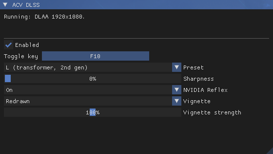

# ACV DLSS

ReShade add-on that replaces Assassin's Creed Valhalla's own anti-aliasing (TAA)
with NVIDIA DLSS. It also adds NVIDIA Reflex.

Needs an NVIDIA RTX graphics card.

## How it works

Valhalla's TAA reads seven textures from one descriptor table. The first three
are the frame, its packed motion vectors and linear depth. The add-on
recognizes that table when the game binds it. On the next draw it:

1. unpacks the motion vectors and converts depth into what DLSS expects
2. runs DLSS with the jitter and camera from the game's own constant buffers
3. sharpens the result with RCAS (optional)
4. redraws the game's screen effects on it
5. copies it into the TAA's own output texture

The game's TAA is skipped. Everything drawn after it works on the DLSS image,
including the HUD.

The game draws some screen effects before the TAA. These are its vignette on
land and underwater, the raven view's radial blur and lens distortion, and an
underwater radial blur and double image. They are fixed to the screen, so they
would smear in DLSS's history when the camera turns. The add-on takes them out
of the image DLSS reads and draws them on DLSS's output in one pass. It uses
the game's own values for them.

When DLSS upscales, the add-on has the game's camera cycle through 16 or 32
sub-pixel positions instead of its usual 8. NVIDIA recommends this for DLSS.

## Resolution scale

The game's **Resolution Scale** setting decides what DLSS does:

- **100%** runs DLAA at your screen's resolution.
- **Below 100%** the game renders smaller and DLSS upscales the frame to your
  screen. The game's pass that stretches its TAA output to the screen gets the
  DLSS image instead. Reflections and other passes that read the TAA output get
  a render-size copy.
- **Above 100%** DLSS runs as DLAA at the larger size. The game scales it down
  as usual.
- **FSR** as the game's upscaler works too. DLSS takes FSR 1's place and FSR
  1's sharpening is skipped. With the resolution scale at 100%, this is the
  best way to render below your screen's resolution because textures keep their
  full detail (see below).

> [!WARNING]
> **Leave the game's Adaptive Quality off.** Dynamic resolution isn't supported
> yet. With it on, the picture flickers between DLSS and the game's TAA
> whenever the internal render resolution changes.

## Texture detail

The game loads texture detail for the resolution scale's size. FSR renders
smaller than that. So with FSR on, the textures get a negative mip LOD bias to
make up the difference. It's -1 at Performance and about -0.38 at Ultra
Quality. With FSR off there's no bias because the game already renders at the
size it loads detail for. Only tiling material textures get it, never screen
effects.

NVIDIA's guidelines add another -1 on top. In this game that asks for detail
it never loads. The ground then turns black up close where leaves and debris
lie, so it isn't used.

DLSS picks up a new FSR mode straight away. The LOD bias needs a restart
because the game builds it into its pipelines at start up. The first start
after the bias changes is slow while the game rebuilds its pipeline cache. Play
for 3 minutes with DLSS on after it, or the next start rebuilds the cache
again.

## Installing

1. Install ReShade 6.8 or newer with add-on support.
2. Download the latest DLSS DLL from
   [TechPowerUp](https://www.techpowerup.com/download/nvidia-dlss-dll/).
3. Copy `acvdlss.addon64` and `nvngx_dlss.dll` next to `ACValhalla.exe`.
   That's where ReShade's DLL is.
4. Set **Anti-aliasing** to **High** in the game's graphics options.
5. Start the game. The first start after installing or updating is slow while
   the game rebuilds its pipeline cache. Play for 3 minutes with DLSS on after
   it.

## Settings

Open the ReShade overlay to find the **ACV DLSS** window. The top of it shows
what DLSS is doing right now. With FSR on it also shows the LOD bias.



- **Enabled** switches between DLSS and the game's own TAA.
- **Toggle key** does the same while playing. It's F10 by default. To map it
  to another key, click the button and press the key. Esc cancels. Backspace
  leaves it without a key. Keys ReShade already uses are skipped. Each switch
  shows "DLSS: On" or "DLSS: Off" in the top-left corner for a few seconds.
- **Preset** chooses the DLSS model. **Auto** lets DLSS pick the one NVIDIA
  recommends for your card. J and K are the first generation of transformer
  models. L and M are the second. E and F are the older CNN models. NVIDIA
  removed A to D from current DLSS and reserves G, H and I, so those act as
  Auto.

  

- **Sharpness** applies AMD's RCAS to the DLSS image before the HUD is drawn.
- **Vignette** chooses how the game's vignette is drawn. **Game's own** is the
  default. The game draws it before DLSS, where it can smear at the edges of
  the screen. **Redrawn** draws it again after DLSS to look like the game's
  own. It doesn't smear, but its colors can differ slightly in some scenes.
- **Vignette strength** goes from 0 to 200% of the game's strength. 0% turns
  the vignette off.
- **NVIDIA Reflex** is covered below.

All settings are saved in `acvdlss.ini` next to `ACValhalla.exe`. The file is
created on the first start. These can only be changed there:

- `ReflexPlacement` under `[Latency]`. See the Reflex section.
- `HudlessImage` under `[OptiScaler]`. See the frame generation section.
- `JitterPositions` under `[Advanced]`: `Auto`, or force 8, 16 or 32 camera
  positions.
- `Debug` under `[Diagnostics]` writes a detailed log.

## NVIDIA Reflex

Reflex is on by default.

- **On** keeps frames from queueing up for the graphics card. Your input
  reaches the screen sooner. In testing at about 35 fps, GPU bound, it cut
  input latency by about a third with no loss in frame rate.
- **On + Boost** also keeps the graphics card's clocks up when the CPU is the
  limit. It makes no difference while the graphics card is the limit.
- With OptiScaler's DLSS frame generation it stays on and gives frame
  generation the game's frame timing. It felt noticeably more responsive in
  testing.
- It switches itself off while OptiScaler's FSR or XeSS frame generation is in
  use. The option is grayed out then. See the next section.
- It overrides frame rate caps that work through Reflex, like RTSS in Reflex
  mode or the NVIDIA App's Max Frame Rate. Use the game's own frame limit
  instead.
- It waits at the game's own frame start, right before the game reads your
  input. The driver paces frames from there, as in a game with built-in
  Reflex. If a tool that also uses Reflex stutters or misbehaves with this, set
  `ReflexPlacement=0` in `acvdlss.ini`. It then waits right after Present.
  `1` waits at the frame start without the driver's pacing.

## Frame generation with OptiScaler

ACV DLSS gives the game a real DLSS integration. So
[OptiScaler](https://github.com/optiscaler/OptiScaler) can run DLSS, FSR or
XeSS frame generation from it. OptiScaler's OptiFG with the **Upscaler** input
works well with it. Tested with the latest OptiScaler nightly builds.

Setup:

1. Install ACV DLSS as above.
2. Install OptiScaler as `winmm.dll` next to `ACValhalla.exe`.
3. Rename ReShade's DLL (usually `dxgi.dll`) to `ReShade64.dll`. Then set
   `LoadReshade = true` in `OptiScaler.ini` so OptiScaler loads ReShade. With
   ReShade as `dxgi.dll`, frame generation can crash the game.
4. In `OptiScaler.ini`, set `FGInput = upscaler`. Set `FGOutput` to `dlssg`,
   `fsrfg` or `xefg`.
5. In game, press **End** (OptiScaler's default key) to turn frame generation
   on or off.

Things to know:

- **No HUD fix needed.** ACV DLSS hands OptiScaler the picture before the HUD
  is drawn through the `Opti.Hudless` parameter. The HUD stays sharp in
  generated frames with OptiScaler's **HUDFix** off. Only recent nightly
  builds read `Opti.Hudless`. An older build needs OptiScaler's HUDFix.
- **Reflex with DLSS frame generation** (`dlssg`): Reflex stays on.
  OptiScaler's **FPS Limit** then caps the frames you see. For 30 real frames
  doubled to 60, set it to 60.
- **Reflex is switched off** while `FGOutput` is `fsrfg` or `xefg`. With FSR
  frame generation it hung the GPU in testing.
- **If a loading screen freezes** with frame generation on, press **End** to
  turn frame generation off before loading a save or fast travelling. Turn it
  back on once you're in. This happened a few times in testing.
- **Disable RTSS for the game.** In RTSS, add `ACValhalla.exe` and set its
  **Application detection level** to **None**. OptiScaler warns about RTSS.
  Its Reflex injection interferes with frame generation's latency handling.

How the outputs behaved in testing:

- **DLSS frame generation** (`dlssg`): smooth, with Reflex from ACV DLSS.
  Needs an RTX 40 or 50 card. Older cards need a community replacement DLL,
  like `dlssg_for_sm86` for RTX 30.
- **FSR frame generation** (`fsrfg`): runs on any RTX card.
- **XeSS frame generation** (`xefg`): runs on any RTX card.

## ReShade effects with the game's motion vectors

ReShade effects can read the motion vectors and depth that DLSS gets from the
game, at render size:

```
texture Motion : ACVDLSS_MOTION; // RG16F: UV offset to where the pixel was a frame ago
texture Depth : ACVDLSS_DEPTH;   // R32F: reversed depth, 1 near and 0 far
```

Both read zero while DLSS isn't running. ReShade's own depth buffer is
unchanged.

These effects are a separate optional download called **ACV DLSS Extras**.
Its zip holds them in `reshade-shaders\Shaders`. Copy the ones you want into
your ReShade shader folder, together with `ACVDLSS.fxh`:

- **ACV DLSS Motion Vectors (for third-party shaders)** copies the game's
  motion vectors into `texMotionVectors`, which other effects read. Move it to
  the top of the list. Turn off any motion estimation effect because both write
  the same texture.
- **ACV DLSS Motion Blur (simple)** blurs each pixel along its own motion.
- **ACV DLSS Motion Blur (depth-aware)** also spreads the blur past the edges
  of moving objects. It uses depth so a blur doesn't smear over things in front
  of it.
- **ACV DLSS View** shows the depth and motion vectors.

Turn the game's own motion blur off when using either blur. The blurs read ACV
DLSS's image without the HUD, so the HUD stays sharp. Keep them at the top of
the list.

Below 100% resolution scale, or with FSR on, the game's depth buffer is
smaller than the screen. ReShade's **Generic Depth** add-on may then not pick
it, and effects that use ReShade's depth stop working. In the **Add-ons** tab
under **Generic Depth**, set **Aspect ratio heuristic** to **Multiples of
resolution (for DLSS or resolution scaling)**. `ACVDLSS_DEPTH` needs no setup.

## Good to know

- Menus and loading screens show the game's own image because the game draws
  them without TAA.
- Dialogue cutscenes work with DLSS too. That includes the letterboxed ones.
- Don't combine it with any other mod that replaces the game's anti-aliasing.
  RenoDX DLSS is the exception. See below.
- Interiors far too bright or shadows turning into blotches, with DLSS on or
  off, mean the game's pipeline cache is damaged. That can happen when the game
  crashes or is closed while it saves new shaders. Close the game and delete
  the `cache` folder in `Documents\Assassin's Creed Valhalla`. The next start
  is slow while the game builds it again.
- ACV DLSS writes `acvdlss.log` next to `ACValhalla.exe`. It starts fresh each
  time the game starts. Attach it together with `acvdlss.ini` when you report a
  problem. Its warnings also appear in ReShade's log.

## With RenoDX DLSS

ShortFuse's RenoDX DLSS works alongside it. Its **Render** and **Upscaled**
hook methods apply DLSS 5 neural rendering inside the DLSS pass with the game's
motion vectors. That gives more stable results than applying it to the final
image.

1. Install ACV DLSS as above.
2. Put `renodx-dlss.addon64` and `nvngx_dlssnr.dll` next to `ACValhalla.exe`
   as well. Official and modified `nvngx_dlssnr.dll` builds both work. ACV
   DLSS leaves DLSS 5 to RenoDX DLSS.

Tested together: RenoDX DLSS 0.2026.1025.409, `nvngx_dlss.dll` and
`nvngx_dlssnr.dll` 310.9.16, ReShade 6.8.0.

Running Lecram's DLSS 5 Neural Rendering (`renodx-dlss5.addon64`) alongside
RenoDX DLSS isn't recommended. If you do, set its **Hook point** to
**Present**. Its other hook points run inside the DLSS pass. With RenoDX DLSS
also there, the game crashes as neural rendering starts.

## Don't stack FSR on a lower resolution scale

The game's FSR stacks on top of the resolution scale. So 70% with FSR
Performance renders at only 35% of your screen. That's too little for DLSS.
Foliage and shadows shimmer noticeably. To render below your screen's
resolution, keep the resolution scale at 100% and pick an FSR mode.

## Building

Visual Studio 2022 and CMake. Clone the dependencies into `deps` first, from
the repository root:

```
git clone --depth 1 --branch v6.8.0 https://github.com/crosire/reshade.git deps\reshade
```

ReShade passes its own ImGui functions to add-ons. So the ImGui commit has to
match the one ReShade pins. For v6.8.0 it's
`3912b3d9a9c1b3f17431aebafd86d2f40ee6e59c`:

```
git clone https://github.com/ocornut/imgui.git deps\imgui
```
```
git -C deps\imgui checkout 3912b3d9a9c1b3f17431aebafd86d2f40ee6e59c
```

Only the headers and libraries of the DLSS SDK are needed. A sparse clone gets
them without the rest:

```
git clone --depth 1 --filter=blob:none --sparse https://github.com/NVIDIA/DLSS.git deps\dlss
```
```
git -C deps\dlss sparse-checkout set include lib/Windows_x86_64/x64
```

Then:

```
cmake -S . -B build -G "Visual Studio 17 2022" -A x64
```
```
cmake --build build --config Release
```

The shaders are compiled with `fxc` from the Windows SDK during the build.
Output: `build\Release\acvdlss.addon64`. The default `acvdlss.ini` is built
into the add-on from the repository's copy.

## Third-party licenses

- [ReShade](https://github.com/crosire/reshade), BSD 3-Clause, copyright Patrick
  Mours. The add-on is built against its add-on API headers.
- [Dear ImGui](https://github.com/ocornut/imgui), MIT, copyright Omar Cornut.
- [NVIDIA DLSS SDK](https://github.com/NVIDIA/DLSS), under the NVIDIA RTX SDKs
  license. DLSS and NVIDIA are trademarks of NVIDIA Corporation.
- `src\reflex.cpp` declares a few structures and interface IDs from
  [NVIDIA's NvAPI](https://github.com/NVIDIA/nvapi), MIT.
- `shaders\rcas.hlsl` follows RCAS from AMD FidelityFX Super Resolution 1, MIT,
  copyright Advanced Micro Devices, Inc.

## Acknowledgements

The DLSS mods for [Assassin's Creed Odyssey](https://www.nexusmods.com/assassinscreedodyssey/mods/466)
and [Assassin's Creed Origins](https://www.nexusmods.com/assassinscreedorigins/mods/339)
were the inspiration for this mod.

[OptiScaler](https://github.com/optiscaler/OptiScaler)'s source was a great
help in getting Reflex right. It showed where the wait goes, which latency
markers to set and how Reflex works together with frame generation.

## Development note

AI assistance was used during development. It helped review code, find bugs,
refine the implementation and write documentation. All changes were reviewed
and tested before being included.

This is not a mere "vibe-coded" mod. I spent countless hours and days on it.
I captured and disassembled the game's shaders to find its TAA pass, jitter
and screen effects. I measured frame times and latency. And I tested every
change in game many times over before keeping it.

## License

MIT
